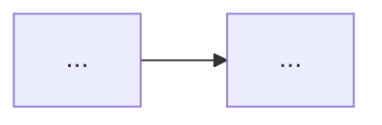

# YouTube → Vietnamese study document

The output is a **lesson**: an article that teaches the video's ideas, organised by concept, illustrated with Mermaid diagrams and frames captured from the video — the kind of document a good tutorial site publishes. It is not a timeline of the video.

The reader is a **dummy**: smart, motivated, zero background. They must understand the whole topic from the document alone, without watching the video. Write in Vietnamese; keep each technical term's original in parentheses the first time it appears — "bộ nhớ đệm (cache)".

Handle each URL independently, one document per video. Scripts live in `~/.claude/skills/yt-study-guide/scripts/`.

## 1. Fetch the transcript

```bash
python3 ~/.claude/skills/yt-study-guide/scripts/fetch_transcript.py "<url>"
```

It takes 1–3 minutes (yt-dlp solves YouTube's JS challenge) — give the command a long timeout. Read the `FOLDER:` line and the last line (status token):

- `OK` → continue.
- `CACHED` → transcript already saved; reuse it. If `GUIDE_EXISTS: true`, ask the user before overwriting `guide.md`.
- `NO_SUBTITLES` → ask the user to paste the transcript. Save their text to `<FOLDER>/pasted.txt`, then run the script again with `--paste <FOLDER>/pasted.txt`.
- `ERROR` → show the error. If yt-dlp is missing, tell the user to run `brew install yt-dlp`.

Done when `<FOLDER>/transcript.txt` exists.

## 2. Notes per chunk (long videos only)

If `<FOLDER>/chunks/` has files, the video is long (>45 min). Write notes for every chunk following [references/chunk-notes.md](references/chunk-notes.md), saved as `chunks/NN.notes.md`. If you have a subagent / parallel-agent tool, give each chunk to its own subagent, passing it the video title and channel, the chunk path, and that reference file; otherwise do the chunks one after another yourself.

Done when every `chunks/NN.txt` has a matching `chunks/NN.notes.md`.

## 3. Outline the lesson

From the notes (or `transcript.txt` for short videos), design the lesson before writing:

- **Outcomes**: 3–5 things the reader will be able to understand or do.
- **Concept sections**: 4–10, ordered so each builds on the previous — beginner foundations first. Group by idea: a point the lecturer makes in three places belongs in one section.
- **Illustrations per section**: which Mermaid diagram explains it, and which moments of the video show something worth a screenshot (UI, slide, diagram, code, demo result). Collect their timestamps from the notes' "Khoảnh khắc nên chụp hình" or from the transcript.

Done when every main idea of the video is assigned to a section, and every section has at least one planned illustration.

## 4. Capture frames

```bash
python3 ~/.claude/skills/yt-study-guide/scripts/extract_frames.py "<url>" "<FOLDER>" --at 05:45 12:30 1:02:10 ...
```

Pass all planned timestamps in one call (typically 6–15). Then **look at every image**. Keep a frame only if it clearly shows what the section explains; for a transition, a face-only shot, a popup covering the content or the wrong screen, retry or drop it. The screen usually changes *after* the lecturer starts talking about it — when the transcript says "let me open X", X often appears 10–40 seconds later, so retry later rather than earlier. Text visible in frames is authoritative: when it spells a tool name, config key or value differently from the auto captions, use the on-screen version in the document. Delete frames you don't use from `<FOLDER>/images/`, and delete `<FOLDER>/.cache/` if it exists.

Done when every remaining image has been viewed and you know what caption it gets.

## 5. Write `<FOLDER>/guide.md`

Follow the template below.

**Voice.** Write like a teacher writing an article: flowing explanatory paragraphs that say what a concept is, why it exists, how it works, and when to use it. Rephrase the lecturer's points into this flow and attribute opinions where useful ("Kun cho rằng…"). Use bullets for real lists only. Friendly, short sentences, "bạn". Completeness beats brevity.

**No timestamps.** The document stands alone: no `mm:ss`, no "ở phút thứ…", no "trong video lúc…". The only video reference is the source line under the title.

**Diagrams.** Mermaid only. Pick the type that matches the idea: `flowchart` for processes and architecture, `sequenceDiagram` for interactions between actors over time, `stateDiagram-v2` for states and lifecycles, `classDiagram` / `erDiagram` for structures and data, `quadrantChart` or a table for comparisons. Mindmaps don't fit this format. Keep node labels short and wrap any label containing punctuation in quotes: `A["Lavish (review)"]`.

**Images.** `` followed by an italic caption that tells the reader what to look at. Number every figure — diagrams and images share one sequence: `*Hình 3: …*`.

**Fidelity.** Content the lecturer said is stated plainly. Anything you add from outside the video — background, a gap the lecturer skipped, a correction, a safety caveat — goes in a callout `> 💡 **Giải thích thêm (ngoài video):** …`. Add these freely wherever a beginner would get stuck. Subtitles from auto captions contain mis-heard words; fix obvious ones silently from context.

**Analogies.** Every non-obvious concept gets one everyday comparison: `🧠 **Ví dụ đời thường:** …`.

### Template

````markdown
# <Vietnamese lesson title>

> 🎬 Bài học dựa trên video [<original title>](<url>) của <channel> (<duration>).

**Mục tiêu:** Sau bài này, bạn sẽ:
- <outcome>

## <Opening: the problem this topic solves and why it matters>
<2–4 paragraphs that make the reader care: the situation, the pain, what the lecture offers.>

## <Concept section>
<Explanatory paragraphs.>


*Hình 1: <what the diagram shows>*


*Hình 2: <what to look at in the screenshot>*

🧠 **Ví dụ đời thường:** <analogy>

> 💡 **Giải thích thêm (ngoài video):** <addition>

## Kết luận
<What the reader now understands, how the pieces fit together, what to do next.>

## Bảng thuật ngữ
| Thuật ngữ | Giải thích siêu dễ hiểu |
|---|---|
| bộ nhớ đệm (cache) | <ELI5 explanation> |

## Những chỗ hay hiểu sai
- ❌ <misunderstanding> → ✅ <correct understanding>

## Tự kiểm tra
1. <question>
   <details><summary>Đáp án</summary><answer + why></details>

## One Pager Cheat Sheet
- <one line per key idea>
````

Completion criteria:

- **Coverage**: every main idea of the video (every "Ý chính" bullet for long videos) is taught in some section.
- **Illustration**: every concept section has at least one Mermaid diagram or captioned frame; every image path exists in `images/`.
- **Bảng thuật ngữ**: every technical term used anywhere in the document is in the table.
- **Tự kiểm tra**: 5–10 questions covering every concept section, mixing recall and "why/apply" questions.
- **One Pager Cheat Sheet**: one line per key idea, covering every section.

## 6. Check and report

Re-read `guide.md` against the completion criteria and fix gaps. Search it for `[0-9]+:[0-9]{2}` to catch stray timestamps (only the duration in the source line may remain). Then tell the user the document path, the transcript source (manual/auto/pasted), and the number of diagrams and images.
