# Chỉ huy cả một đội AI agent mà không rối: quy trình firstmate của Kun Chen

> 🎬 Bài học dựa trên video [High Throughput Agentic Engineering with Kun](https://www.youtube.com/watch?v=MSbacZ99E14) của Kun Chen (53:57).

**Mục tiêu:** Sau bài này, bạn sẽ:
- Hiểu vì sao khi làm việc với AI agent, **sự chú ý của con người** mới là thứ khan hiếm nhất — và cách tổ chức công việc để tiết kiệm nó.
- Nắm được mô hình "con tàu": thuyền trưởng (bạn), thuyền phó (firstmate), thuyền phó thứ hai (second mate) và thủy thủ (crewmate).
- Biết cách chọn đúng model và công cụ cho từng loại việc, dựa trên quy tắc và hạn mức còn lại.
- Biết cách theo dõi hàng chục việc chạy song song và ra quyết định nhanh mà không bỏ sót.
- Biết chọn mức kiểm soát chất lượng phù hợp với mức rủi ro của từng thay đổi.

## Vì sao làm việc với nhiều agent lại dễ rối?

Kun Chen từng là kỹ sư principal (cấp L8) ở Meta, Microsoft và Atlassian. Hiện anh tự xây và duy trì **36 dự án** — phần lớn là mã nguồn mở — gần như hoàn toàn bằng AI agent. Các video trước của anh dạy những kiến thức nền về kỹ thuật dùng agent (agentic engineering). Video này đi xa hơn: làm sao để **nhiều agent cùng làm việc song song** với năng suất cao (high throughput) mà người điều khiển không bị quá tải.

Khi mới dùng agent, ta thường mở một phiên, giao việc, rồi ngồi chờ. Muốn làm nhanh hơn, ta mở thêm phiên thứ hai, thứ ba… Nhưng rồi bạn sẽ thấy mình trở thành "người chuyển tab": liên tục nhảy qua lại giữa các cửa sổ, đọc lại xem phiên này đang làm gì, phiên kia đang chờ gì, việc nào đã xong, quyết định nào còn treo. Mỗi lần chuyển như vậy là một lần **chuyển ngữ cảnh (context switch)** — não phải "nạp lại" toàn bộ bối cảnh, rất tốn sức.

Lời giải của Kun là một công cụ mã nguồn mở anh tự viết tên **firstmate** ([kunchenguid/firstmate](https://github.com/kunchenguid/firstmate)). Ý tưởng cốt lõi rất đơn giản: **bạn chỉ nói chuyện với đúng một agent**. Agent đó lo phần còn lại.

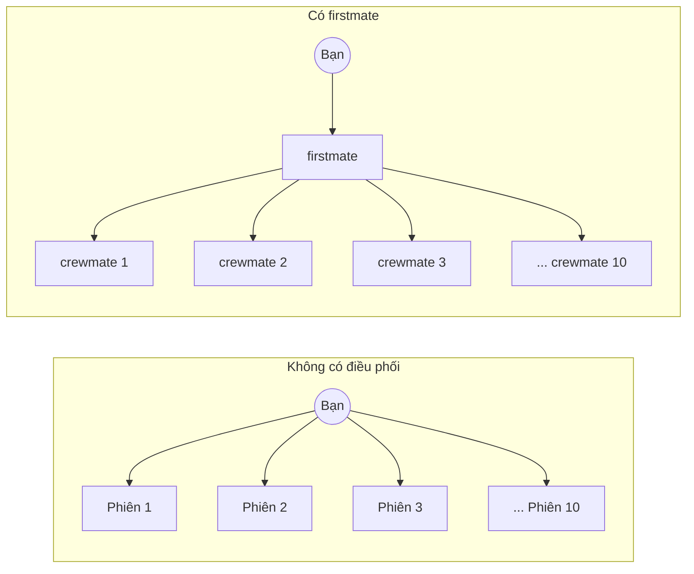
*Hình 1: Bên trái, bạn phải tự quản lý từng phiên. Bên phải, bạn chỉ nói với firstmate, và firstmate quản lý các phiên còn lại.*

Xuyên suốt video, Kun nhấn mạnh một niềm tin: **tài nguyên quý nhất khi làm việc với agent là thời gian và sự chú ý của con người**. Mọi công cụ và thói quen trong bài này đều phục vụ một mục đích — để đầu óc bạn rảnh mà suy nghĩ về câu hỏi quan trọng nhất: *nên xây cái gì?*

## 1. Mô hình con tàu: thuyền trưởng, thuyền phó và thủy thủ

firstmate mượn hình ảnh một con tàu. Kun mở đầu video bằng câu "hi captains" — chào các thuyền trưởng — vì trong mô hình này, **bạn là thuyền trưởng**.

**firstmate (thuyền phó)** là agent duy nhất bạn trò chuyện. Điểm đặc biệt: firstmate **không tự viết code**. Khi bạn giao việc, nó tự xác định việc đó thuộc dự án nào, tìm lại kế hoạch đã bàn trước đó (nếu có), rồi tạo ra một agent khác để làm. Vì không bao giờ bận tay làm việc, firstmate **luôn rảnh để nghe bạn** — bạn có thể giao việc mới bất cứ lúc nào, kể cả khi nó đang xử lý việc cũ.

**crewmate (thủy thủ)** là agent "công nhân" do firstmate tạo ra để làm đúng một việc cụ thể. Mỗi crewmate chạy trong một tab terminal riêng, với model và công cụ được chọn riêng cho loại việc đó. Kun hầu như không bao giờ nhìn vào các crewmate — anh chỉ nhận báo cáo qua firstmate.

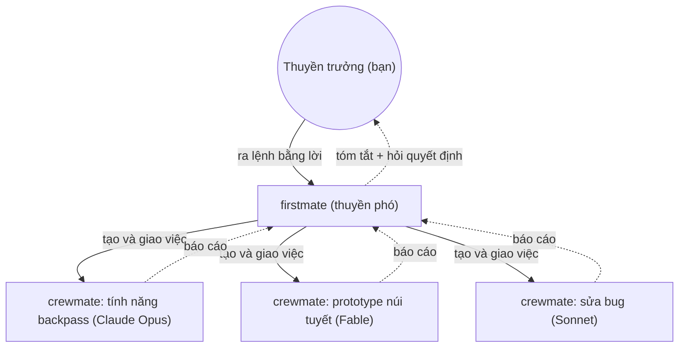
*Hình 2: Luồng công việc trong firstmate. Lệnh đi xuống, báo cáo đi lên, và bạn chỉ làm việc với tầng trên cùng.*

Ví dụ đầu tiên trong video: Kun nói với firstmate rằng trước đây họ đã lên kế hoạch cho công cụ **backpass** (công cụ đọc lại các phiên agent cũ để đề xuất cải thiện file hướng dẫn `AGENTS.md` / `CLAUDE.md`) thu thập dữ liệu từ nhiều máy từ xa — "lấy kế hoạch đó ra và cử một crewmate làm đi". firstmate tự tìm lại bản kế hoạch, tạo crewmate, rồi báo lại:

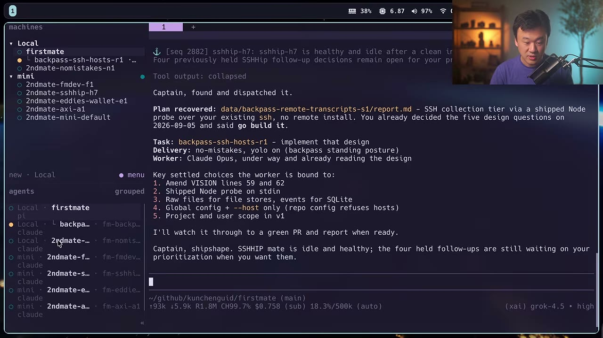
*Hình 3: Báo cáo của firstmate sau khi giao việc: "Plan recovered" (đã tìm lại kế hoạch), tên task, cách giao hàng (no-mistakes), worker là Claude Opus, và 5 quyết định thiết kế đã chốt từ trước mà crewmate phải tuân theo. Ở panel bên trái, crewmate `backpass-ssh-hosts-r1` xuất hiện ngay dưới firstmate.*

Cài đặt firstmate cũng đơn giản như ý tưởng của nó: clone repo về, rồi khởi chạy agent ngay trong thư mục repo đó. Agent đọc các file hướng dẫn có sẵn trong repo và tự hiểu mình đóng vai thuyền phó.

🧠 **Ví dụ đời thường:** Bạn là chủ nhà đang sửa nhà. Thay vì tự gọi thợ điện, thợ sơn, thợ ống nước và đứng canh từng người, bạn thuê một cai thầu. Bạn chỉ nói với cai thầu "làm lại bếp, sơn phòng khách". Cai thầu tự gọi thợ, tự phân việc, và chỉ hỏi bạn những thứ cần chủ nhà quyết, như chọn màu sơn nào.

> 💡 **Giải thích thêm (ngoài video):** "Clone repo là chạy được" là vì repo firstmate chứa sẵn file hướng dẫn, skill và cấu hình. Bạn vẫn phải tự cài các công cụ agent mà nó điều khiển (Pi, Claude Code, Codex…) và có tài khoản hoặc gói thuê bao của từng nhà cung cấp. Thói quen ở ví dụ trên cũng đáng học: **lên kế hoạch trước, lưu lại, rồi mới giao cho agent làm**. Tách giai đoạn suy nghĩ khỏi giai đoạn thực thi giúp agent làm đúng ý bạn hơn.

## 2. Bộ đồ nghề: model, harness và trình ghép terminal

Để hiểu firstmate hoạt động thế nào, cần phân biệt ba lớp công cụ mà Kun dùng.

**Model (mô hình ngôn ngữ)** là "bộ não" AI: Claude Opus, Fable, Grok, GPT… Mỗi model có điểm mạnh riêng. **Harness (vỏ agent)** là phần mềm bọc quanh model để biến nó thành agent làm việc được — cung cấp công cụ đọc file, chạy lệnh, tạo ảnh… Claude Code, Codex, Pi và Cursor đều là harness. Cùng một model có thể chạy trong nhiều harness khác nhau, và harness quyết định agent có **những công cụ gì**. Kun dùng Claude Code khi muốn chạy model của Anthropic, còn **Pi** cho mọi trường hợp khác, vì Pi đổi model rất dễ. Bản thân firstmate của anh chạy trên Pi với model Grok 4.5.

Lớp ngoài cùng là **trình ghép terminal (terminal multiplexer)** — công cụ cho phép chạy nhiều phiên terminal trong một cửa sổ và chuyển qua lại dễ dàng, giống tmux. Kun dùng **herdr**, công cụ mà anh gọi là "tmux mới" của mình. herdr hiển thị mọi phiên agent ở panel bên trái, và còn quản lý được phiên trên **nhiều máy khác nhau** (sẽ nói ở mục 7).

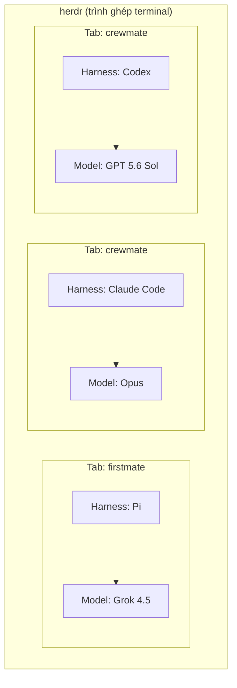
*Hình 4: Ba lớp công cụ. herdr chứa nhiều tab, mỗi tab là một harness, và mỗi harness chạy một model.*

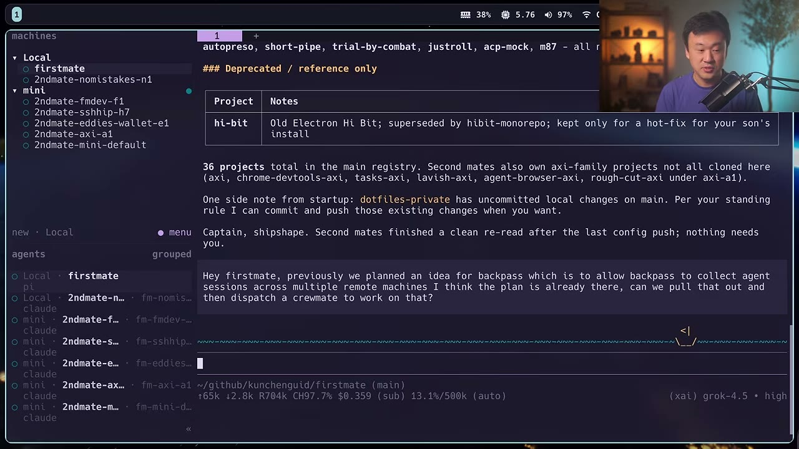
*Hình 5: Toàn cảnh màn hình làm việc của Kun. Panel trái của herdr chia theo máy ("Local" và "mini"), liệt kê firstmate và các second mate. Khung phải là phiên firstmate: danh sách 36 dự án, rồi lệnh giao việc cho backpass mà Kun vừa đọc bằng giọng nói. Dòng trạng thái dưới cùng cho thấy model `grok-4.5` và context đã dùng `13.1%/500k`. Dải sóng có con thuyền nhỏ là chế độ calm (mục 3).*

Hai thói quen nhỏ khác của Kun. Thứ nhất, anh ra lệnh **bằng giọng nói** (voice input) gần như mọi lúc, vì nói nhanh hơn gõ với những câu tự nhiên. Chỉ khi cần nhập thứ phải chính xác từng ký tự như URL thì anh mới gõ. Thứ hai, anh không tin rằng model mới ra là tốt hơn. Grok 4.6 đã có, nhưng anh vẫn thích 4.5 vì nhanh và đi thẳng vào vấn đề. Theo anh, 4.6 — giống Opus 5 — có "tính cách" hơi lạ. Lời khuyên của anh: hãy tự dùng một model mới một thời gian để cảm nhận, đồng thời đọc thêm nhận xét của người khác.

🧠 **Ví dụ đời thường:** Model là người tài xế, harness là chiếc xe. Cùng một tài xế giỏi, lái xe tải thì chở được hàng, lái xe con thì đi nhanh. herdr là bãi đỗ xe có camera, cho bạn nhìn thấy tất cả xe đang chạy từ một chỗ.

> 💡 **Giải thích thêm (ngoài video):** Tên model (Fable, Opus 5, Grok 4.5, GPT 5.6 Sol, Kimi K3…) là của thời điểm quay video và sẽ nhanh chóng lỗi thời. Thứ nên nhớ là **nguyên tắc**: chọn model theo loại việc, và tự kiểm chứng model mới thay vì tin quảng cáo.

## 3. Giữ đầu óc rảnh: ẩn nhiễu và gửi lệnh đúng lúc

Khi agent làm việc, terminal thường tràn ngập thông tin: đọc file này, chạy lệnh kia, tìm kiếm chỗ nọ. Mỗi hành động như vậy gọi là một **lệnh gọi công cụ (tool call)**. Kun cho rằng phần lớn thời gian, những thứ này chỉ là **nhiễu**. Bạn không cần biết agent đọc file nào — bạn cần biết nó có đang chạy không và kết quả ra sao.

Vì vậy anh viết một extension cho Pi tên **calm**, đi kèm repo firstmate. Gõ `/calm` để bật: mọi tool call biến mất, chỉ còn một con thuyền nhỏ trôi qua lại trên dải sóng (thấy ở cuối Hình 5) để bạn biết agent chưa bị treo. Thỉnh thoảng chuỗi suy nghĩ (chain of thought) của agent lướt qua rồi tắt. Khi cần xem chi tiết, gõ `/calm` lần nữa để tắt chế độ này. Theo Kun, không phải nhìn nhiễu giúp anh tập trung nghĩ việc tiếp theo cần làm.

Thói quen thứ hai liên quan đến **cách gửi prompt** trong Pi. Có hai cách:

- **Follow-up** (Alt+Enter): prompt được **xếp hàng**. Agent chỉ đọc nó sau khi làm xong việc hiện tại. Nhờ vậy agent không bị phân tâm và làm từng việc một cho trọn.
- **Steer** (Enter): prompt được gửi **ngay lập tức** để chen ngang và đổi hướng agent.

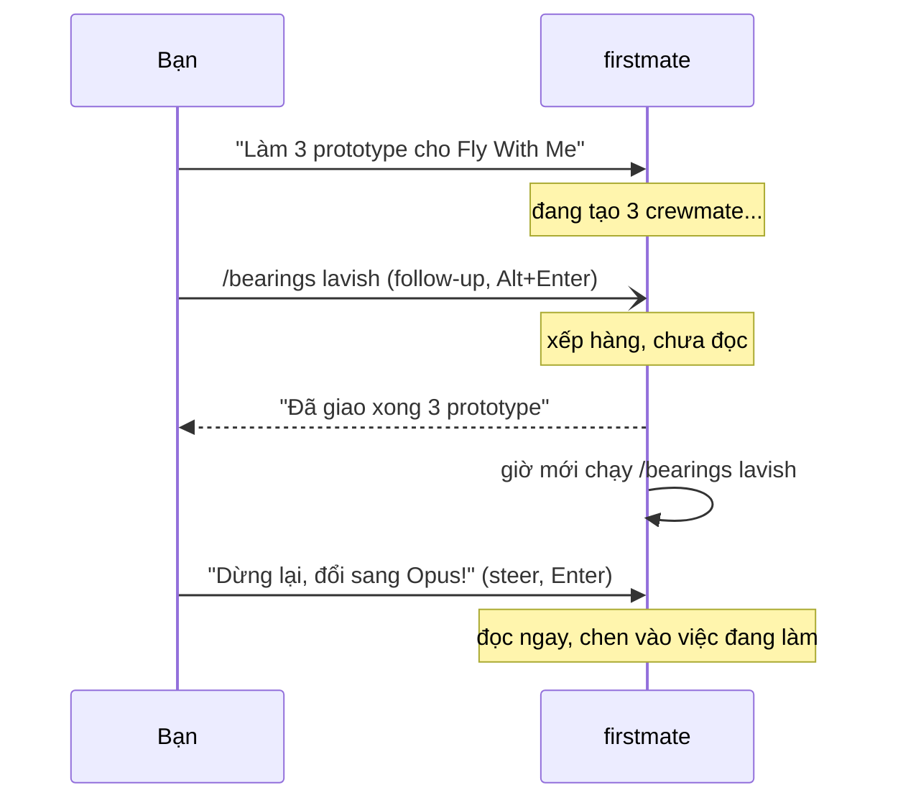
*Hình 6: Follow-up chờ tới lượt, còn steer chen ngang ngay.*

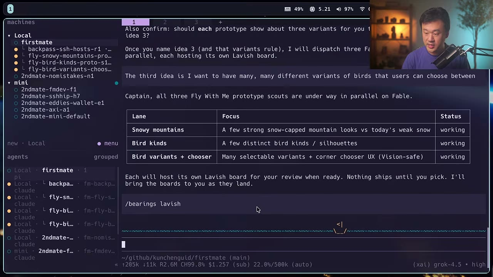
*Hình 7: firstmate báo cả ba prototype của Fly With Me (núi tuyết, các loại chim, bộ chọn biến thể chim) đều đang "working" song song trên Fable. Lệnh `/bearings lavish` mà Kun gửi dạng follow-up nằm ngay bên dưới, chờ tới lượt. Panel trái lúc này có 4 crewmate dưới firstmate.*

Một hệ quả quan trọng: **Kun không bao giờ ngồi chờ**. Ngay cả khi firstmate đang bận, anh vẫn tiếp tục nói thêm ý tưởng. Đó là cách anh luôn giữ được rất nhiều việc chạy song song.

🧠 **Ví dụ đời thường:** Follow-up giống để lại tờ giấy nhắn trên bàn đồng nghiệp: "xong việc thì xem cái này nhé". Steer giống vỗ vai họ: "dừng lại, nghe tôi ngay".

> 💡 **Giải thích thêm (ngoài video):** Ẩn tool call **không** có nghĩa là bỏ qua kiểm tra chất lượng. Việc kiểm tra được chuyển sang những chỗ hiệu quả hơn: xem prototype bằng mắt (mục 5) và các dây chuyền kiểm định tự động (mục 10). Mục tiêu là giảm tải cho não bạn, không phải nhắm mắt tin agent.

## 4. Chọn đúng model cho đúng việc

Mỗi khi chuẩn bị tạo crewmate, firstmate phải trả lời hai câu hỏi: dùng **harness** nào và **model** nào? Kun không để nó đoán. Anh có một file quy tắc tên **`crew-dispatch.json`** trong thư mục cấu hình. Điều thú vị là anh **không viết file này bằng tay**: anh chỉ nói sở thích của mình cho firstmate, và firstmate tự cập nhật file.

Các quy tắc của Kun:

| Loại việc | Dùng gì | Lý do |
|---|---|---|
| Tính năng mới cho app iOS trả phí | Claude + Fable | Fable giỏi làm giao diện đẹp, và app có người trả tiền nên cần chăm chút |
| Việc cần tạo hình ảnh | Codex + GPT 5.6 Sol | Codex có sẵn công cụ tạo ảnh, vì OpenAI có model tạo ảnh |
| Thiết kế sản phẩm, kiến trúc, kế hoạch khó và mơ hồ | Fable, Kimi K3 hoặc Astra | Cần model suy luận mạnh |
| Sửa lỗi đơn giản, đã rõ nguyên nhân gốc (root cause) và kết quả mong đợi | Luna, Sonnet, hoặc Cursor + Grok 4.6 | Việc dễ, không cần model đắt |
| Mặc định, khi không khớp quy tắc nào | Claude Opus, hoặc Cursor + Grok 4.6 (mức high) | — |

Mỗi quy tắc có ba phần: **when** (khi nào áp dụng), **use** (dùng harness và model gì) và **why** (lý do). Phần "why" rất quan trọng: nó giúp model hiểu *ý đồ* đằng sau quy tắc, nhờ đó tự phán đoán đúng cả khi gặp tình huống không khớp hoàn toàn.

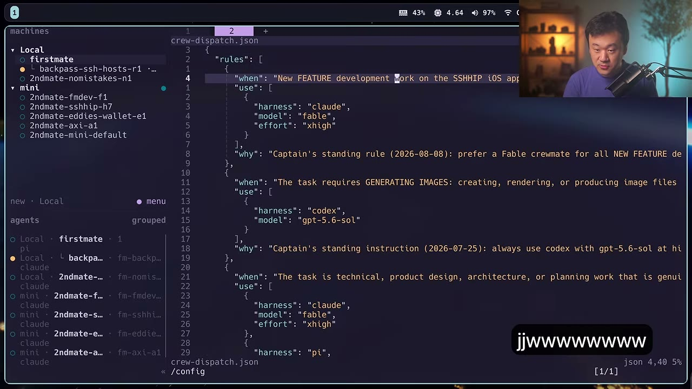
*Hình 8: Một đoạn file `crew-dispatch.json`. Mỗi quy tắc có `when` (mô tả loại việc), `use` (harness, model, mức effort) và `why` (lý do, ghi cả ngày thuyền trưởng ra quy định). Ví dụ quy tắc thứ hai: việc tạo ảnh dùng harness `codex` với model `gpt-5.6-sol`.*

Khi một quy tắc cho phép nhiều model (ví dụ ba model cho việc lập kế hoạch khó), firstmate chọn model **còn nhiều hạn mức (quota) nhất**. Kun trả tiền cho nhiều gói thuê bao (Claude, Codex, Cursor, Grok), và mỗi gói có hạn mức sử dụng riêng. Để không lãng phí, anh viết thêm công cụ **quota-axi**: giao diện dạng màn hình (TUI) để người xem, và giao diện dòng lệnh (CLI) để agent đọc. firstmate gọi quota-axi trước mỗi lần giao việc — Kun gọi đây là cách giao việc "có tính đến hạn mức" (quota-aware dispatch).

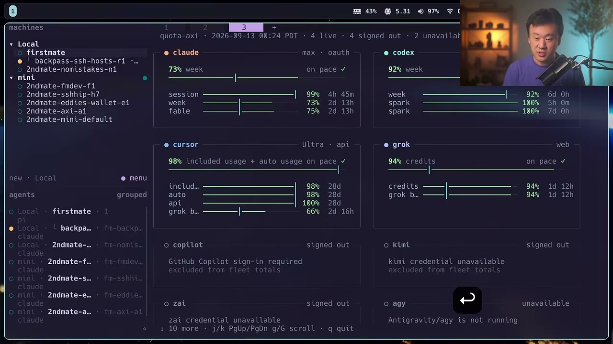
*Hình 9: Giao diện TUI của quota-axi hiển thị hạn mức còn lại của từng gói: Claude (73% tuần, Fable 75%), Codex (92%), Cursor (98%), Grok (94%). Các dịch vụ chưa đăng nhập như Copilot hay Kimi bị loại khỏi tổng.*

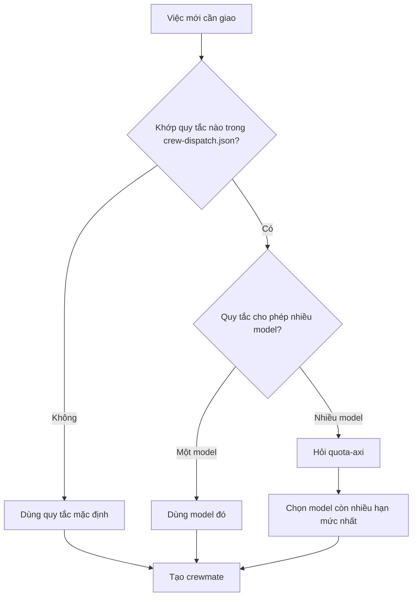
*Hình 10: Cách firstmate chọn harness và model cho một crewmate.*

Theo Kun, việc này đặc biệt hữu ích vì hạn mức thay đổi liên tục — chẳng hạn quota của Codex thường được reset bất ngờ — nên tự theo dõi bằng tay là không thể.

🧠 **Ví dụ đời thường:** Giống bếp trưởng xếp ca. Món cầu kỳ giao cho đầu bếp chính, rửa rau giao cho phụ bếp. Và khi có hai người cùng làm được một món, ưu tiên người hôm nay còn nhiều giờ làm nhất, để không ai bị bỏ phí.

> 💡 **Giải thích thêm (ngoài video):** Bạn không cần nhiều gói thuê bao mới áp dụng được ý tưởng này. Chỉ với một nhà cung cấp, bạn vẫn nên có quy tắc kiểu "việc dễ dùng model rẻ và nhanh, việc khó dùng model mạnh" — vừa tiết kiệm tiền, vừa nhanh hơn.

## 5. Thử nhiều phương án, rồi chọn bằng mắt

Một trong những thói quen hiệu quả nhất của Kun là **làm nhiều phương án thử (prototype) rồi chọn**, thay vì cố mô tả thật chính xác mình muốn gì ngay từ đầu.

Ví dụ trong video là **Fly With Me**, một game thư giãn Kun để chạy trên màn hình phụ: một chú chim bay qua thế giới được **sinh theo thuật toán** (procedurally generated), mỗi lần chơi một khác. Anh "nói lan man" ba ý tưởng cho firstmate: làm núi tuyết đẹp hơn, thêm cực quang xuất hiện ngẫu nhiên vào bầu trời đêm, và cho người chơi chọn nhiều loại chim. Với mỗi ý tưởng, anh yêu cầu **ba biến thể (variant)**, mỗi ý tưởng giao cho **một crewmate chạy song song**, và kết quả gửi về qua **Lavish**. Anh chọn model Fable vì quota-axi cho thấy Fable còn dư nhiều — "tại sao không dùng?".

**Lavish** là công cụ biến kết quả của agent thành một **trang HTML tương tác** để bạn xem, so sánh, chọn và gửi phản hồi ngay trên trang. Bảng "các loại chim" chụp ảnh chú chim hiện tại để làm mốc, rồi hiển thị từng loại mới ở nhiều góc nhìn:

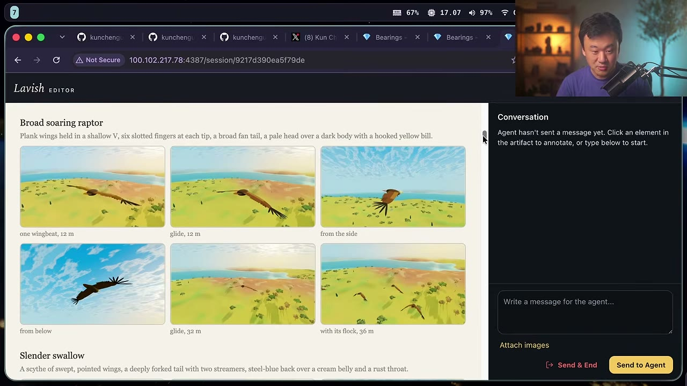
*Hình 11: Bảng Lavish cho loại chim "broad soaring raptor" (chim săn mồi sải cánh rộng): mô tả hình dáng, rồi 6 ảnh xem trước — vỗ cánh, lượn, nhìn từ bên, từ dưới, bay theo đàn. Bên phải là khung hội thoại để gửi phản hồi trực tiếp cho agent.*

Cuối mỗi bảng là phần **quyết định kèm khuyến nghị** của agent. Kun chọn giữ chim săn mồi, chim én, sếu và cú, còn bỏ "chim biển lớn" vì nó quá giống con hiện tại. Anh gửi lại một câu ngắn: "let's build the birds we decided". Phản hồi đi **thẳng về crewmate** đã làm prototype, và crewmate tiếp tục làm thật. Đó là toàn bộ việc con người phải làm.

Với núi tuyết, quy trình có thêm một vòng góp ý (feedback). Crewmate làm rất kỹ — có tính toán, thậm chí có cả "mô hình khí hậu" cho tuyết — và đưa ra nhiều nghiên cứu đổ bóng:

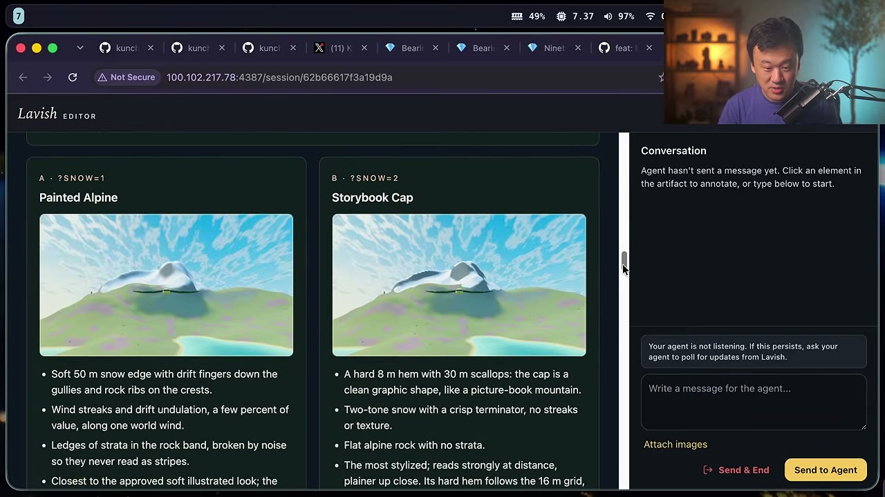
*Hình 12: Hai trong số các biến thể núi tuyết: "Painted Alpine" (mép tuyết mềm, có vệt gió) và "Storybook Cap" (chỏm tuyết như tranh truyện). Mỗi biến thể có ảnh xem trước và danh sách đặc điểm kỹ thuật.*

Kun thích bản "carved peaks" nhưng chưa chốt, vì anh muốn đỉnh núi trông giống **Everest** hơn. Thay vì nói chung chung "chưa đẹp", anh viết: *"Phần lớn đã tốt, nhưng hãy đi tìm ảnh đỉnh Everest và K2, rồi làm núi của ta trông gần như vậy."* Ở vòng sau, crewmate đã tự tìm ảnh thật và đưa chúng vào bảng làm tham chiếu:

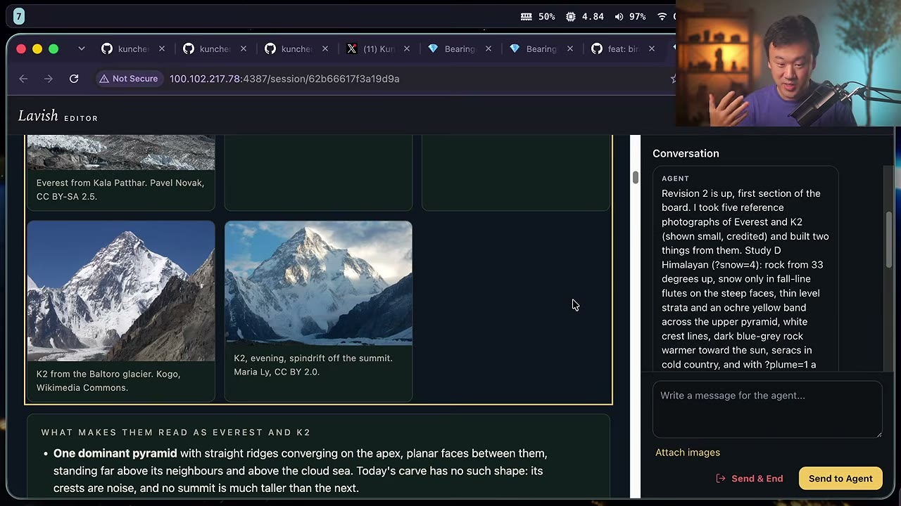
*Hình 13: Vòng 2 của bảng núi tuyết. Agent tìm 5 ảnh tham chiếu của Everest và K2 (có ghi nguồn và giấy phép), rồi phân tích "điều gì khiến chúng trông giống Everest và K2": một khối kim tự tháp nổi trội, các sống núi hội tụ về đỉnh. Bên phải, agent giải thích bản "Study D Himalayan" được xây từ những ảnh này.*

Kết quả là một **biến thể D** mới, có cả đá lẫn tuyết, trông thật hơn hẳn. Kun dùng chế độ so sánh để đặt các bản cạnh nhau, chọn D, và yêu cầu đổi dáng núi từ đỉnh chóp sang **cao hơn và nhọn hơn**.

Bảng tiếp theo là bộ chọn chim. Agent không chỉ làm giao diện mà còn tự kiểm tra nó chạy tốt trên điện thoại, rồi gom các điểm cần chọn thành mục **"decisions for the captain"**: bộ chọn đặt ở đâu, khi người chơi không chọn thì chim mang màu gì, phần nào từ đợt thăm dò (scout) nên được làm thật.

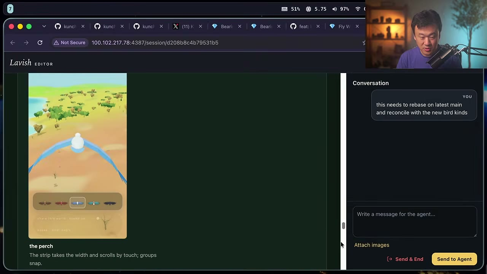
*Hình 14: Bản xem trước bộ chọn chim trên khung điện thoại ("the perch"): dải chọn nằm dưới đáy màn hình, vuốt được bằng tay, các nhóm chim tự căn vị trí. Bên phải là lời nhắn Kun gửi cho agent.*

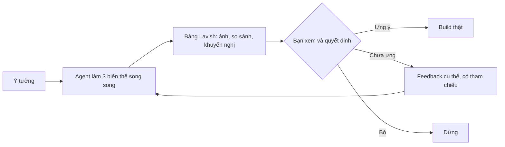
*Hình 15: Vòng lặp prototype. Agent làm nhiều phương án, bạn chọn bằng mắt, rồi góp ý cụ thể cho tới khi ưng ý.*

Kun tóm tắt vì sao cách làm này hiệu quả: agent mang quyết định đến **kèm rất nhiều ngữ cảnh** — phần "bài tập về nhà" (nghiên cứu agent đã làm), hình ảnh và prototype chạy được. Nhờ đó anh hiểu agent đã làm gì, đang phải chọn giữa những gì, và dẫn nó tới kết quả mình hài lòng.

🧠 **Ví dụ đời thường:** Khi chọn sơn tường, bạn không mô tả màu bằng lời cho thợ. Bạn xin ba mẫu sơn, quét thử lên tường, đứng nhìn rồi chỉ: "cái này, nhưng sáng hơn một chút".

> 💡 **Giải thích thêm (ngoài video):** Cách này hiệu quả vì với agent, **viết code rất rẻ**, còn thời gian suy nghĩ của bạn thì đắt. Làm ba phương án rồi chọn rẻ hơn nhiều so với một vòng mô tả, làm, sửa, làm lại. Bài học về feedback cũng áp dụng ở mọi nơi: "chưa đẹp" khiến agent đoán mò, còn "giống Everest và K2, hãy đi tìm ảnh" cho nó một mục tiêu cụ thể để tự kiểm tra.

## 6. Không bỏ sót việc: bearings, captain's call và ahoy

Khi chạy hàng chục việc trên nhiều dự án, vấn đề lớn nhất không phải là làm, mà là **nhớ**: việc nào đã xong, việc nào đang chạy, và quyết định nào *đã bàn nhưng chưa chốt*. firstmate có hai skill sẵn để giải quyết chuyện này.

**bearings** chụp nhanh trạng thái mọi việc trên toàn hạm đội (fleet). Bản mặc định in ra terminal hơi khó đọc, nên Kun dùng biến thể **bearings-lavish** để xuất thành trang Lavish. Báo cáo chia việc thành các nhóm: **charted next** (đã lên kế hoạch, chờ làm), **underway** (đang làm), **landed recently** (vừa xong). Trên cùng là mục quan trọng nhất: **captain's call** — những quyết định chỉ thuyền trưởng mới chốt được.

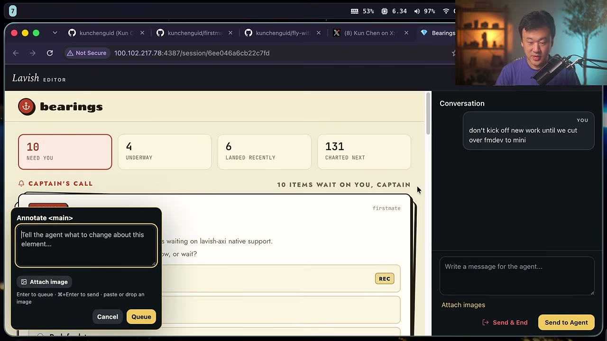
*Hình 16: Báo cáo bearings. Bốn ô trên cùng: 10 việc cần bạn (need you), 4 đang chạy, 6 vừa xong, 131 đã lên kế hoạch. Mục "Captain's call" ghi "10 items wait on you, captain". Khung "Annotate" đang mở là nơi gõ góp ý cho từng mục; bên phải là hội thoại với agent.*

Kun đi qua từng mục và chọn: **làm ngay**, **để sau**, hoặc **giữ lại để bàn kỹ** (hold). Ví dụ: Claude Code gần đây thêm hộp thoại xác nhận khi thoát mà còn việc chạy nền, làm việc thoát bị chặn → xử lý. Lỗi xuống dòng URL trong app Ship → là bug, sửa ngay. Dạy người dùng mới của Ship về trình ghép terminal → phức tạp, tạm hold. Chọn xong, anh gửi tất cả về firstmate trong một lần. Phần việc của Ship nhiều đến mức firstmate chuyển nó cho một second mate (mục 7).

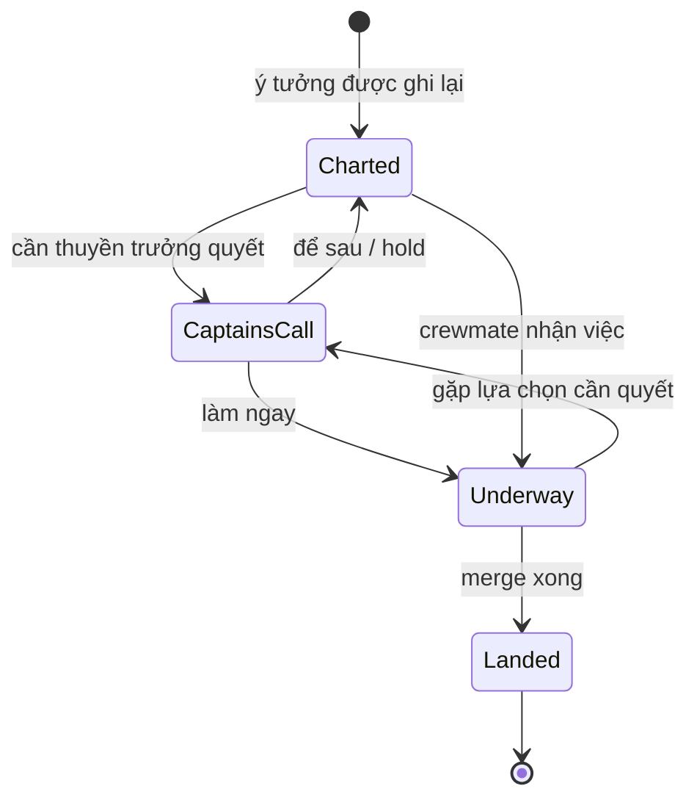
*Hình 17: Vòng đời của một việc trong firstmate. Báo cáo bearings đếm số việc ở từng trạng thái, và mọi việc rơi vào "captain's call" sẽ được gom lại cho bạn.*

Skill thứ hai là **ahoy**, dùng để **bắt kịp** tình hình. Trong một phiên dài, firstmate in ra rất nhiều tin nhắn, và rất khó biết mình đã đọc hết chưa — đây là giới hạn của giao diện chat. `ahoy` yêu cầu firstmate tóm tắt mọi thứ nó đã báo **kể từ tin nhắn cuối cùng của bạn**, chia thành việc đã xong, đang chạy, đang chờ bạn, và các quyết định còn mở. Vì chỉ là tóm tắt nên nó rất rẻ, gọi bao nhiêu lần cũng được.

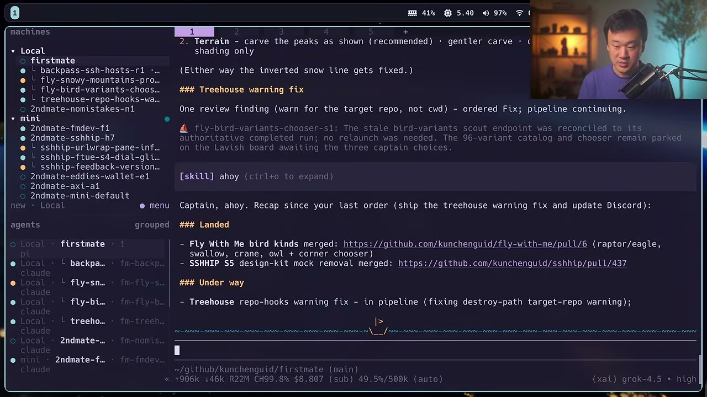
*Hình 18: Kết quả của `ahoy`: "Recap since your last order", với mục Landed (bộ chọn các loại chim của Fly With Me đã merge, kèm link PR; bản gỡ mock của SSHHIP đã merge) và mục Under way (bản sửa cảnh báo của Treehouse đang trong pipeline).*

Có một chi tiết thú vị: `ahoy` vẫn liệt kê núi tuyết là "quyết định còn mở", dù Kun đã góp ý rồi. Lý do là phản hồi qua Lavish đi **thẳng tới crewmate**, không qua firstmate. firstmate chỉ biết khi crewmate báo cáo lại. Kun thấy chuyện này chấp nhận được, vì trạng thái sẽ tự đồng bộ sau đó.

Cuối video, Kun cũng tự phát hiện prototype **cực quang** chưa hề được bắt đầu — không có crewmate nào làm nó. Anh chấp nhận và để làm sau. Đây là lời nhắc rằng ngay cả với công cụ tốt, việc vẫn có thể lọt; vì vậy nên chạy bearings hoặc ahoy định kỳ.

🧠 **Ví dụ đời thường:** `ahoy` giống hỏi đồng nghiệp sau khi bạn họp xong: "Trong lúc tôi vắng có gì mới, và có việc gì đang chờ tôi quyết không?". Còn bearings giống tấm bảng Kanban dán trên tường văn phòng.

> 💡 **Giải thích thêm (ngoài video):** Tên các mục trong báo cáo (herdr, Ship, dial, design kit…) là dự án riêng của Kun, bạn không cần hiểu từng mục. Điều đáng học là **quy trình**: gom mọi quyết định đang treo về một chỗ, duyệt hàng loạt, rồi gửi lại một lần — thay vì để chúng rải rác trong hàng trăm tin nhắn.

## 7. Mở rộng quy mô: second mate và nhiều máy

Khi số việc tăng lên, chính firstmate cũng có thể bị quá tải: nó bận điều phối đến mức không còn thời gian trò chuyện với bạn. Giải pháp của Kun là **second mate (thuyền phó thứ hai)**.

Mỗi second mate **sở hữu một mảng (domain)** trong phạm vi trách nhiệm (charter) của firstmate. Ví dụ second mate "ship" nhận mọi việc liên quan đến app Ship. Khi Kun nói gì đó về Ship, firstmate chỉ cần chuyển yêu cầu sang, không phải tự điều phối nữa. Điều quan trọng: **mỗi second mate thực chất là một firstmate hoàn chỉnh**, với crewmate, bộ nhớ (memory) và chỉ dẫn (instructions) riêng. Bạn có thể vào nói chuyện thẳng với nó, hoặc hỏi firstmate để nó tự chuyển. Kun thường chọn cách dễ hơn: chỉ nói với firstmate.

Ví dụ: Kun quên mất tính năng nào của app ví đã lên App Store, nên hỏi second mate của app ví: "Những tính năng nào đã merge nhưng chưa phát hành?". Nó trả lời có vài tính năng (như thanh toán tự động) đã vào code chính mà chưa phát hành. Kun tạm gác lại vì đang có đủ việc.

Second mate còn giúp chia việc sang **máy khác**. Nhờ herdr quản lý được phiên trên nhiều máy, Kun chạy phần lớn second mate trên một **Mac Mini** đặt trên kệ, chạy không màn hình (headless). Mac Mini mạnh hơn chiếc MacBook đang dùng, nên chạy được nhiều agent hơn.

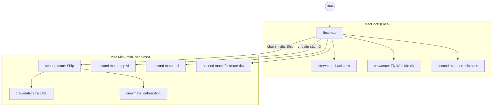
*Hình 19: Cấu trúc hạm đội của Kun. firstmate chạy trên MacBook, các second mate phần lớn chạy trên Mac Mini, và mỗi second mate tự quản crewmate của mình.*

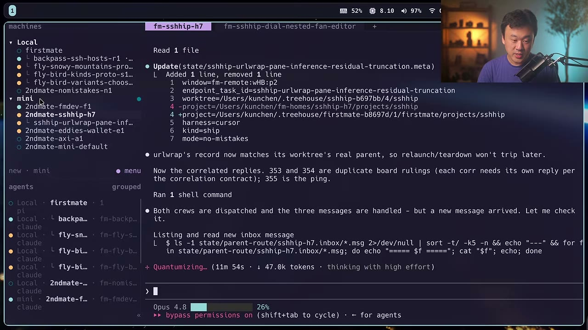
*Hình 20: Panel trái của herdr chia theo máy. Dưới "Local" là firstmate cùng các crewmate (backpass, núi tuyết, các loại chim, bộ chọn chim). Dưới "mini" là các second mate, trong đó `2ndmate-sshhip-h7` đã tự tạo crewmate sửa lỗi xuống dòng URL. Khung phải là phiên của second mate Ship đang làm việc.*

🧠 **Ví dụ đời thường:** Công ty nhỏ thì giám đốc quản lý hết nhân viên. Khi công ty lớn lên, giám đốc lập các trưởng phòng — mỗi trưởng phòng tự quản đội của mình, giám đốc chỉ nói chuyện với trưởng phòng. Văn phòng chật thì mở thêm chi nhánh ở tòa nhà khác.

> 💡 **Giải thích thêm (ngoài video):** Vì sao một agent lại "quá tải"? Mỗi agent chỉ có **một luồng chú ý** và **một cửa sổ ngữ cảnh** (mục 9). Điều phối quá nhiều việc thì ngữ cảnh đầy nhanh và phản hồi chậm. Chia theo mảng giúp mỗi agent chỉ phải nhớ phần của mình.

## 8. Một bộ não, nhiều cửa vào: gọi firstmate từ Discord và X

Kun có một server Discord cộng đồng (khoảng 1.000–2.000 thành viên) với kênh báo lỗi (bug reports). Thay vì tự đọc và điều tra từng báo cáo, anh **@mention bot firstmate ngay trong Discord**. Bot này **chuyển tiếp (relay)** tin nhắn về đúng phiên firstmate đang chạy trên máy anh. Tương tự, trên **X (Twitter)**, khi có người phàn nàn một thông báo trong app Ship khó hiểu, anh chỉ cần mention firstmate: "cải thiện thông báo này đi".

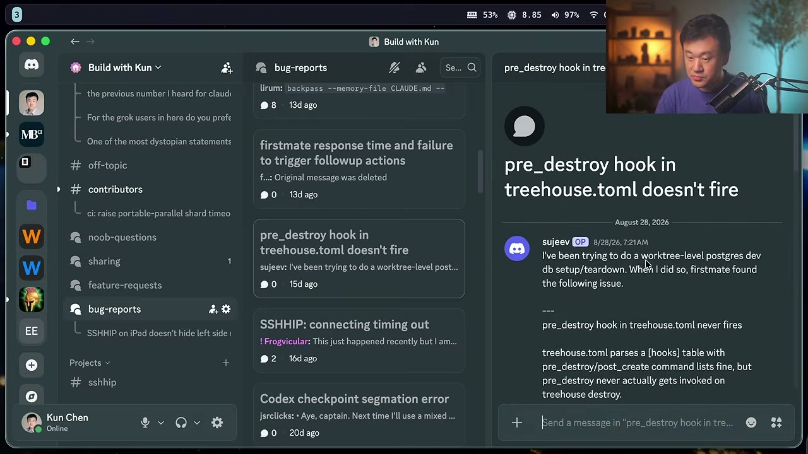
*Hình 21: Kênh bug-reports trên server Discord "Build with Kun". Báo cáo đang mở: "pre_destroy hook in treehouse.toml doesn't fire" — hook `pre_destroy` khai báo trong file cấu hình của Treehouse không bao giờ chạy.*

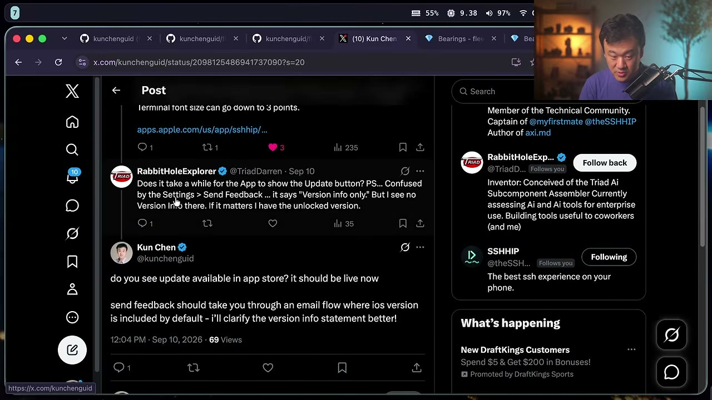
*Hình 22: Một người dùng trên X bối rối với dòng "Version info only" trong Settings → Send Feedback của app SSHHIP. Kun trả lời sẽ làm rõ thông báo đó.*

firstmate trả lời trên cả hai nơi bằng câu quen thuộc "Aye captain…", rồi giao việc điều tra cho crewmate. Kết quả điều tra lỗi Treehouse cho thấy một tình huống thú vị:

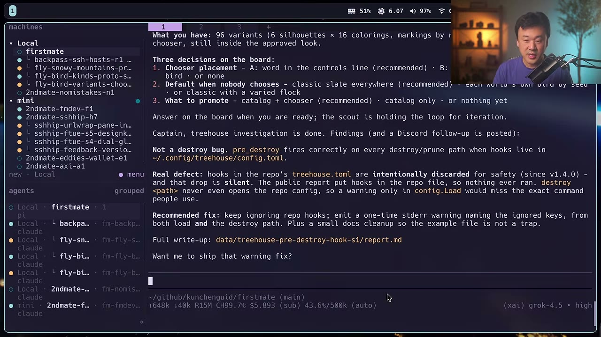
*Hình 23: Báo cáo điều tra. "Not a destroy bug": hook vẫn chạy đúng khi khai báo trong file cấu hình của người dùng. "Real defect": hook khai báo trong file cấu hình của repo bị **cố ý bỏ qua vì lý do bảo mật**, nhưng bỏ qua **âm thầm**. "Recommended fix": giữ nguyên việc bỏ qua, chỉ thêm một cảnh báo hiện ra một lần.*

Kun nhớ ra đây là quyết định bảo mật có chủ đích, nên đồng ý giữ nguyên hành vi và chỉ thêm cảnh báo. Anh bảo firstmate "ship bản sửa và trả lời thread Discord luôn". Sau đó, khi tạo PR, GitHub trả **lỗi máy chủ (lỗi 500)**. firstmate tự cho phép thử lại, GitHub hoạt động trở lại, PR được tạo — Kun không phải làm gì.

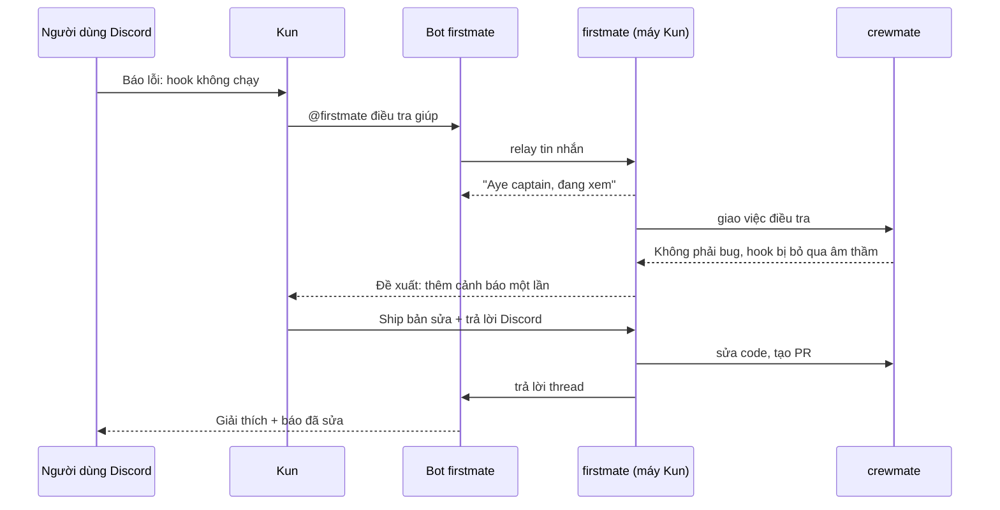
*Hình 24: Một báo lỗi đi từ Discord, qua firstmate, tới crewmate, rồi quay lại người báo.*

Điểm mấu chốt: mọi kênh đều đổ về **một phiên agent duy nhất**. Phiên đó nắm toàn bộ ý định và ngữ cảnh của mọi dự án, nên là nơi tốt nhất để điều phối.

🧠 **Ví dụ đời thường:** Giống tổng đài chăm sóc khách hàng: khách gọi điện, nhắn Zalo hay gửi email thì tất cả đều về cùng một hệ thống, và cùng một người nắm toàn bộ lịch sử xử lý.

> 💡 **Giải thích thêm (ngoài video):** Cần cẩn thận về **bảo mật**. Nếu bất kỳ ai cũng mention được bot, thì về lý thuyết ai cũng gửi được lệnh tới agent đang chạy trên máy bạn — agent đó có quyền đọc code, chạy lệnh, tạo PR. Video không nói Kun giới hạn quyền thế nào. Nếu tự làm, hãy đảm bảo chỉ bạn hoặc người tin cậy mới ra lệnh được. Bài học từ lỗi Treehouse cũng đáng nhớ: tự động chạy hook có sẵn trong repo của người khác có thể khiến **code lạ chạy trên máy bạn**, nên chặn là đúng — chỉ là phải *báo* cho người dùng biết.

## 9. Cửa sổ ngữ cảnh: đặt ngưỡng rồi quên đi

**Cửa sổ ngữ cảnh (context window)** là lượng chữ tối đa mà model "nhìn thấy" cùng lúc trong một phiên, tính bằng token. Phiên càng dài, ngữ cảnh càng đầy: mỗi lượt trả lời tốn nhiều tiền hơn, và model có thể kém đi vì phải chú ý tới quá nhiều thứ cũ không liên quan. Khi ngữ cảnh gần đầy, harness có thể **nén (compact)** — tóm tắt lịch sử hội thoại để giải phóng chỗ trong khi vẫn giữ ý chính.

Nhiều người hỏi Kun có nên tự quản lý chuyện này không: reset phiên thường xuyên, nén thủ công, tối ưu từng chút. Anh thừa nhận tối ưu ngữ cảnh có lợi thật — tiết kiệm tiền, agent "thông minh" hơn. **Nhưng anh khuyên đừng tự làm bằng tay.** Lý do quay về niềm tin cốt lõi của video: nút thắt lớn nhất là sự chú ý của con người. Dồn sức vào những tối ưu lặt vặt thì bạn không còn năng lượng nghĩ *nên xây cái gì*. Chấp nhận lãng phí một chút cũng không sao, và các harness sẽ dần tự lo việc này.

Lời khuyên cụ thể duy nhất của anh: **đặt một ngưỡng nén tự động cố định**, khoảng **500 nghìn token**. Pi của anh đã nén ở mức này (thấy `…/500k (auto)` ở dòng trạng thái trong Hình 5). Riêng Claude Code mặc định cho ngữ cảnh tới 1 triệu token — Kun cho là quá cao — nên anh đặt một biến môi trường để Claude Code tự nén khi chạm 500 nghìn:

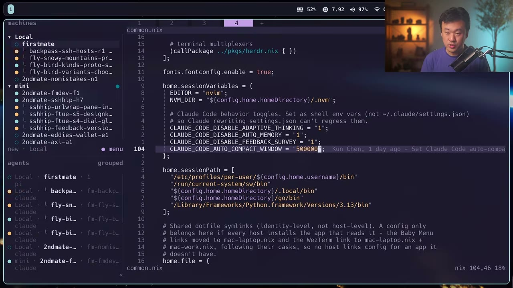
*Hình 25: File cấu hình cá nhân (dotfiles, viết bằng Nix) của Kun. Trong `home.sessionVariables`, dòng được tô sáng là `CLAUDE_CODE_AUTO_COMPACT_WINDOW = "500000"`. Ghi chú phía trên giải thích anh đặt các tùy chọn của Claude Code bằng biến môi trường thay vì `settings.json`, để Claude không tự ghi đè được.*

Nếu bạn không dùng Nix, cách tương đương là thêm một dòng vào file cấu hình shell (ví dụ `~/.zshrc`):

```bash
export CLAUDE_CODE_AUTO_COMPACT_WINDOW=500000
```

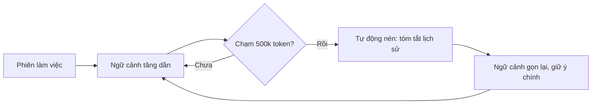
*Hình 26: Đặt ngưỡng một lần, sau đó harness tự lo — bạn không phải nghĩ tới nữa.*

🧠 **Ví dụ đời thường:** Thay vì ngày nào cũng ngồi dọn hộp thư, bạn đặt bộ lọc "tự lưu trữ thư cũ hơn 30 ngày" một lần rồi quên nó đi, dành thời gian cho việc quan trọng hơn.

> 💡 **Giải thích thêm (ngoài video):** Tên biến môi trường lấy từ màn hình của Kun ở thời điểm quay. Các tùy chọn của Claude Code có thể đổi theo phiên bản, nên hãy đối chiếu với tài liệu chính thức của phiên bản bạn đang dùng.

## 10. Kiểm soát chất lượng theo mức rủi ro: merge thẳng hay no-mistakes?

Khi agent tạo ra hàng chục thay đổi mỗi ngày, bạn không thể tự review hết. Nhưng cũng không thể merge tất cả mà không kiểm tra. Lời giải của Kun: **mức kiểm soát tỉ lệ với mức rủi ro**, và quy định sẵn cho từng dự án.

Trong thư mục data của firstmate có file **`projects.md`**, mỗi dự án được gắn một chính sách (policy). Các thành phần chính:

- **direct-PR**: mỗi thay đổi tạo một PR thẳng, không qua dây chuyền kiểm định.
- **no-mistakes**: thay đổi phải đi qua **no-mistakes** — một công cụ khác của Kun, là dây chuyền kiểm định (validation pipeline) nghiêm ngặt có **review đối kháng** (adversarial review: một agent cố tình tìm lỗi trong thay đổi của agent khác).
- **+yolo**: nếu mọi thứ trông ổn, firstmate được tự **merge thẳng (YOLO merge)** mà không cần hỏi bạn.

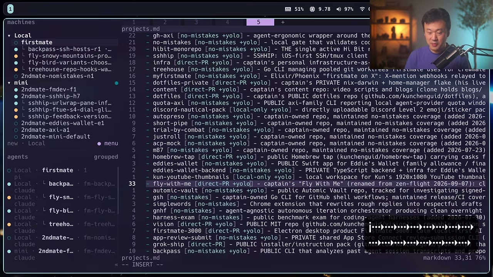
*Hình 27: File `projects.md`. Mỗi dòng là một dự án kèm chính sách trong ngoặc vuông. Dòng được chọn: `fly-with-me [direct-PR +yolo]`. Phần lớn dự án khác là `[no-mistakes +yolo]`, còn một số như `gsh` hay `simplewords` chỉ có `[no-mistakes]` — tức phải chờ thuyền trưởng duyệt.*

Fly With Me dùng `direct-PR +yolo` vì nó chỉ là đồ chơi, không ai phụ thuộc vào nó, lỗi không gây hại thật. Vì vậy trong video, một PR của nó được merge mà Kun thậm chí không biết — đúng như anh đã dặn. Những dự án bật yolo thường là nơi code chưa được phát hành ngay, còn cơ hội kiểm thử trước khi release.

no-mistakes rất mạnh nhưng tốn thời gian và token, nên Kun không dùng nó cho mọi thay đổi. Anh đưa ra một **quy tắc ngón tay cái**:

> *"Với thay đổi này, bình thường bạn có nhờ một đồng nghiệp review không?"*
> Có → bật no-mistakes. Không → có lẽ không cần.

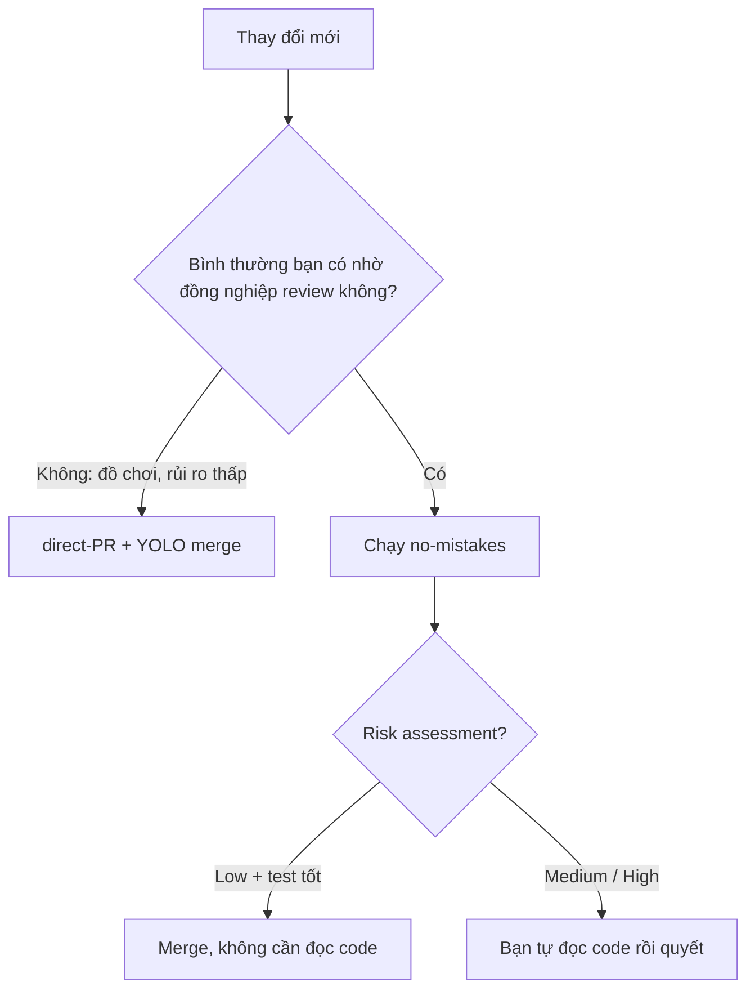
*Hình 28: Cách chọn mức kiểm soát chất lượng cho một thay đổi.*

Cuối video, Kun mở một PR đã đi qua no-mistakes — bản sửa cảnh báo của Treehouse ở mục 8 — để cho thấy nó trông thế nào. PR có bốn phần: **Intent** (ý định: chính là yêu cầu của Kun), **What changed** (tóm tắt thay đổi), **Risk assessment** (đánh giá rủi ro) và **Testing** (kiểm thử).

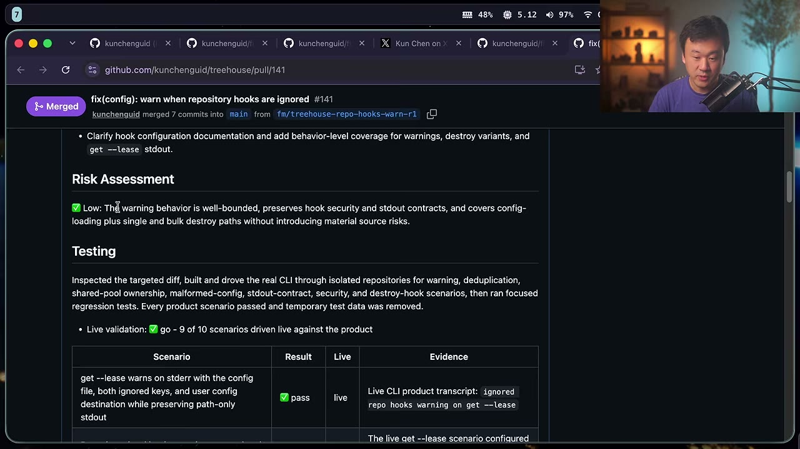
*Hình 29: PR "fix(config): warn when repository hooks are ignored" đã merge. Risk Assessment ghi "✅ Low": hành vi cảnh báo có giới hạn rõ ràng, giữ nguyên bảo mật của hook. Phần Testing mô tả agent đã build và chạy CLI thật trong các repo cô lập: "9 of 10 scenarios driven live against the product".*

Risk assessment ghi **low, medium hoặc high**. Mức medium hay high xuất hiện khi PR có **bán kính ảnh hưởng (blast radius)** lớn — tức nếu có lỗi thì nhiều phần hệ thống bị ảnh hưởng — hoặc còn vấn đề chưa giải quyết. Phần Testing liệt kê từng **kịch bản (scenario)** mà các agent đã chạy **trực tiếp trên sản phẩm thật** (kiểm thử đầu-cuối, end-to-end), kèm bằng chứng:

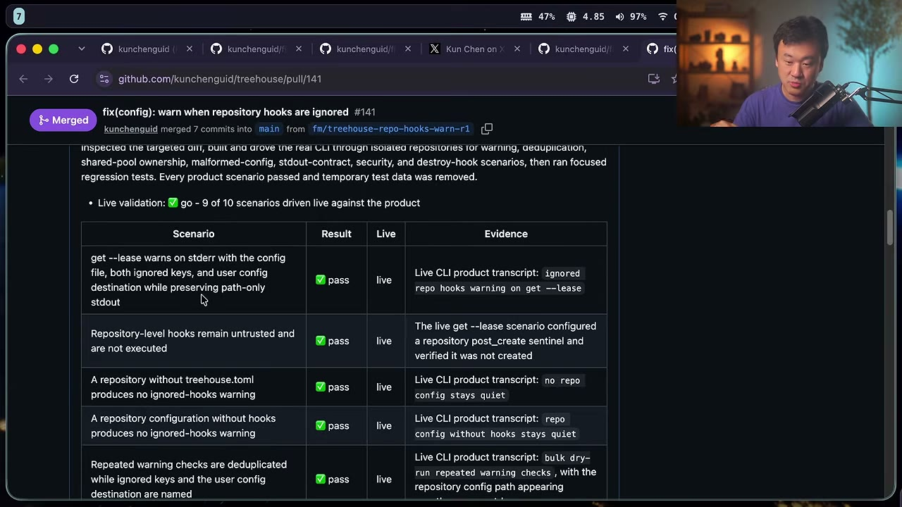
*Hình 30: Bảng kịch bản kiểm thử. Mỗi dòng gồm kịch bản, kết quả (pass), chạy live hay không, và bằng chứng. Ví dụ: cảnh báo in ra stderr với đủ thông tin; hook cấp repo vẫn bị coi là không tin cậy và không được chạy; repo không có cấu hình thì không có cảnh báo; cảnh báo lặp lại được gộp thành một lần.*

Một kịch bản bị bỏ qua — kiểm tra tài liệu có chỉ người dùng tới đúng chỗ không — vì đó là tài liệu, không cần chạy thử. Bị bỏ qua không có nghĩa là thất bại; quan trọng là đọc lý do.

Từ đây, Kun có quy tắc quyết định **có đọc code hay không**:
- Rủi ro **không phải low** → anh đọc code.
- Rủi ro **low** và **được kiểm thử tốt** → thường anh không đọc code, và thường là ổn.

Risk assessment cộng với Testing là cách anh xây dựng sự tự tin vào một thay đổi **mà không phải đọc từng dòng code**. Với Treehouse còn thêm một lớp an toàn: dự án này không tự động phát hành, và Kun tự kiểm thử trước mỗi lần release.

🧠 **Ví dụ đời thường:** Đổi màu tường phòng ngủ thì tự làm luôn. Sửa đường điện cả nhà thì phải có thợ kiểm tra, có biên bản nghiệm thu ghi rõ đã thử những gì. Mức kiểm tra tỉ lệ với hậu quả nếu làm sai.

> 💡 **Giải thích thêm (ngoài video):** "Không đọc code" là kết quả của **nhiều lớp an toàn chồng lên nhau**: chính sách theo mức rủi ro, kiểm thử đầu-cuối có bằng chứng, đánh giá rủi ro, và kiểm thử trước khi phát hành. Nếu bạn mới bắt đầu, hãy vẫn đọc code cho tới khi đã thực sự tin vào dây chuyền kiểm định của mình.

## Kết luận

Quy trình của Kun xoay quanh một ý: **sự chú ý của bạn là tài nguyên đắt nhất, hãy bảo vệ nó**. Mọi mảnh ghép trong bài đều phục vụ điều đó:

- Chỉ nói chuyện với **một** agent (firstmate). Nó điều phối crewmate, và khi quá tải thì chia việc cho second mate, kể cả trên máy khác.
- **Ẩn nhiễu** (`/calm`) và **xếp hàng lệnh** (follow-up) để không bị kéo vào chi tiết.
- Để quy tắc và dữ liệu hạn mức **tự chọn model**, thay vì nghĩ lại mỗi lần.
- **Làm nhiều phương án rồi chọn bằng mắt**, và góp ý cụ thể, có tham chiếu.
- Dùng **bearings** và **ahoy** để không bỏ sót việc hay quyết định nào.
- Đặt **ngưỡng nén ngữ cảnh** một lần rồi quên đi.
- Chọn **mức kiểm soát chất lượng theo rủi ro**, và dựa vào đánh giá rủi ro cùng kiểm thử để quyết định khi nào cần đọc code.

Bạn không cần dùng đúng firstmate để áp dụng những ý này. Hãy bắt đầu từ thứ nhỏ nhất: lần tới khi làm việc với agent, để ý xem bạn đang tốn sự chú ý vào đâu, và hỏi "phần này có thể giao đi hoặc tự động hoá không?". Repo [firstmate](https://github.com/kunchenguid/firstmate) là mã nguồn mở, và cộng đồng Discord của Kun là nơi tốt để trao đổi kinh nghiệm.

## Bảng thuật ngữ

| Thuật ngữ | Giải thích siêu dễ hiểu |
|---|---|
| kỹ thuật dùng agent (agentic engineering) | Làm phần mềm bằng cách giao việc cho AI agent thay vì tự gõ hết code. |
| AI agent | Chương trình AI tự đọc code, chạy lệnh, sửa file để hoàn thành việc bạn giao. |
| năng suất cao (high throughput) | Hoàn thành thật nhiều việc cùng lúc nhờ chạy nhiều agent song song. |
| chuyển ngữ cảnh (context switch) | Bỏ dở việc này để nhảy sang việc khác; mỗi lần chuyển, não mất thời gian "nạp lại" bối cảnh. |
| firstmate (thuyền phó) | Agent "quản lý" duy nhất bạn trò chuyện. Nó không tự code, chỉ chia việc và theo dõi. Cũng là tên repo của Kun. |
| crewmate (thủy thủ) | Agent "công nhân" do firstmate tạo ra để làm đúng một việc, chạy trong tab riêng. |
| second mate (thuyền phó thứ hai) | Một firstmate phụ, sở hữu riêng một mảng việc (ví dụ một app), có crewmate riêng. |
| hạm đội (fleet) | Toàn bộ dự án và agent mà firstmate quản lý. |
| phạm vi trách nhiệm (charter) | Toàn bộ vùng việc firstmate chịu trách nhiệm; second mate nhận một phần. |
| điều phối (orchestrate) / giao việc (dispatch) | Chia việc, giao cho agent phù hợp, theo dõi và gom kết quả. |
| model (mô hình ngôn ngữ, LLM) | "Bộ não" AI phía sau agent: Claude Opus, Fable, Grok, GPT… |
| harness (vỏ agent) | Phần mềm bọc quanh model để nó thành agent làm việc được, quyết định agent có công cụ gì: Claude Code, Codex, Pi, Cursor. |
| Pi | Một harness chạy trong terminal, đổi model dễ, mở rộng được bằng extension. firstmate chạy trên Pi. |
| trình ghép terminal (terminal multiplexer) | Công cụ chạy nhiều phiên terminal trong một cửa sổ và chuyển qua lại dễ dàng (ví dụ tmux). |
| herdr | Trình ghép terminal Kun dùng; quản lý được phiên agent trên nhiều máy. |
| lệnh gọi công cụ (tool call) | Một hành động nhỏ của agent: đọc file, chạy lệnh, tìm kiếm… |
| chuỗi suy nghĩ (chain of thought) | Phần "nghĩ thành lời" của model trong lúc làm việc. |
| `/calm` | Extension Pi đi kèm firstmate: ẩn tool call, chỉ hiện con thuyền báo agent đang chạy. |
| follow-up / steer | Hai cách gửi prompt trong Pi: follow-up (Alt+Enter) xếp hàng chờ; steer (Enter) chen ngang ngay. |
| token | Đơn vị chữ mà model đọc và tính tiền; 1 token ≈ ¾ từ tiếng Anh. |
| hạn mức (quota) | Lượng sử dụng còn lại trong gói thuê bao của mỗi nhà cung cấp AI. |
| quota-axi | Công cụ của Kun hiển thị hạn mức mọi gói: TUI cho người, CLI cho agent. |
| TUI / CLI | Giao diện dạng màn hình trong terminal (cho người) / giao diện dòng lệnh (cho máy đọc). |
| `crew-dispatch.json` | File quy tắc: loại việc nào → harness + model nào, kèm lý do (why). |
| nguyên nhân gốc (root cause) | Lý do thật sự gây ra lỗi, không phải triệu chứng bên ngoài. |
| prototype (bản thử) / biến thể (variant) | Bản làm nhanh để xem ý tưởng có ổn không; làm vài phiên bản để chọn. |
| sinh theo thuật toán (procedurally generated) | Nội dung (bản đồ, địa hình) do thuật toán tạo, mỗi lần một khác. |
| Lavish | Công cụ biến kết quả của agent thành trang HTML tương tác để xem, so sánh, chọn và góp ý. |
| feedback (góp ý) | Nhận xét gửi lại cho agent; tốt nhất là cụ thể và có tham chiếu. |
| scout (đợt thăm dò) | Đợt agent nghiên cứu và làm prototype trước khi làm thật. |
| skill | Gói hướng dẫn có tên mà agent gọi ra dùng khi cần. |
| bearings | Skill của firstmate: chụp nhanh trạng thái mọi việc trên toàn hạm đội. |
| captain's call | Những quyết định chỉ thuyền trưởng (bạn) mới chốt được. |
| charted next / underway / landed | Đã lên kế hoạch / đang làm / đã xong (đã merge). |
| ahoy | Skill của firstmate: tóm tắt mọi thứ đã báo từ tin nhắn cuối của bạn, kèm các quyết định còn mở. |
| máy không màn hình (headless) | Máy chạy không gắn màn hình, chuột, bàn phím; điều khiển từ xa. |
| relay (chuyển tiếp) | Bot trên Discord/X nhận tin nhắn @mention rồi chuyển về phiên firstmate trên máy Kun. |
| hook | Script tự chạy khi có sự kiện; chạy hook lạ từ repo người khác có thể nguy hiểm. |
| lỗi 500 (internal server error) | Lỗi phía máy chủ (ở đây là GitHub); thường tự hết, chỉ cần thử lại. |
| cửa sổ ngữ cảnh (context window) | Lượng token tối đa model nhìn thấy cùng lúc trong một phiên. |
| nén ngữ cảnh (compact) | Tóm tắt lịch sử hội thoại để giải phóng chỗ trong context window. |
| biến môi trường (environment variable) | Giá trị cấu hình đặt trong shell mà chương trình đọc khi chạy. |
| dotfiles | Các file cấu hình cá nhân (`.zshrc`, `.gitconfig`…), thường lưu trong một repo riêng. |
| PR (pull request) | Đề nghị gộp một nhánh thay đổi vào code chính, thường có review. |
| merge thẳng (YOLO merge) | Gộp PR luôn, không cần người review ("You Only Live Once"). |
| no-mistakes | Công cụ của Kun: dây chuyền kiểm định nghiêm ngặt trước khi merge. |
| review đối kháng (adversarial review) | Một agent cố tình tìm lỗi trong thay đổi của agent khác. |
| `projects.md` | File chính sách của firstmate: mỗi dự án merge theo cách nào (direct-PR, no-mistakes, yolo). |
| đánh giá rủi ro (risk assessment) | Mức low/medium/high cho biết thay đổi nguy hiểm tới đâu. |
| bán kính ảnh hưởng (blast radius) | Phạm vi hệ thống bị ảnh hưởng nếu thay đổi có lỗi. |
| kiểm thử đầu-cuối (end-to-end) | Chạy thử sản phẩm thật theo từng kịch bản, không chỉ kiểm thử từng hàm nhỏ. |
| kịch bản kiểm thử (scenario) | Một tình huống cụ thể chứng minh thay đổi hoạt động đúng ý định. |
| stderr (standard error) | Luồng đầu ra dành cho lỗi và cảnh báo của chương trình dòng lệnh. |

## Những chỗ hay hiểu sai

- ❌ "firstmate tự viết code cho mọi việc" → ✅ firstmate chỉ **điều phối**: tạo crewmate, giao việc, theo dõi. Nhờ không tự code nên nó luôn rảnh nói chuyện với bạn.
- ❌ "Chạy nhiều agent là để máy làm nhanh hơn" → ✅ Nút thắt thật sự là **sự chú ý của con người**. Mọi công cụ trong bài (calm, bearings, ahoy, Lavish) đều để tiết kiệm sự chú ý của bạn.
- ❌ "Model mới nhất luôn tốt nhất" → ✅ Kun vẫn thích Grok 4.5 hơn 4.6. Hãy tự dùng thử và chọn model theo **loại việc** và hạn mức còn lại.
- ❌ "Harness và model là một" → ✅ Cùng một model chạy được trong nhiều harness; harness quyết định agent có **công cụ** gì (ví dụ chỉ Codex tạo được ảnh).
- ❌ "Phải tối ưu context window thủ công cho thật gọn" → ✅ Kun khuyên **đặt ngưỡng nén tự động (~500k) rồi quên đi**, dành sức cho việc quyết định nên xây gì.
- ❌ "Ẩn tool call hay không đọc code là bất cẩn" → ✅ Việc kiểm soát chất lượng được chuyển sang chỗ hiệu quả hơn: xem prototype bằng mắt, kiểm thử đầu-cuối và đánh giá rủi ro. Thay đổi rủi ro cao Kun vẫn đọc code.
- ❌ "Mọi PR đều phải qua no-mistakes" → ✅ Tùy **mức rủi ro**: dự án đồ chơi thì merge thẳng; thay đổi mà bình thường bạn sẽ nhờ người review thì bật no-mistakes.
- ❌ "Follow-up và steer giống nhau" → ✅ Follow-up **xếp hàng** chờ agent xong việc; steer **chen ngang** ngay — dùng nhầm có thể làm agent bỏ dở việc đang làm.
- ❌ "Góp ý trên Lavish thì firstmate biết ngay" → ✅ Góp ý đi **thẳng tới crewmate**; firstmate chỉ biết khi crewmate báo lại, nên trạng thái có thể lệch tạm thời.
- ❌ "Kịch bản kiểm thử bị bỏ qua nghĩa là thất bại" → ✅ Phải đọc lý do. Trong ví dụ, kịch bản bị bỏ qua chỉ liên quan đến tài liệu nên không cần chạy thử.
- ❌ "Các tính năng chim, núi tuyết, cực quang là khái niệm kỹ thuật" → ✅ Đó chỉ là tính năng của game ví dụ. Thứ cần học là **quy trình**: prototype → chọn → góp ý → làm thật.

## Tự kiểm tra

1. Vai trò của firstmate và crewmate khác nhau thế nào? Vì sao cách chia này giúp Kun ít phải chuyển ngữ cảnh?
   <details><summary>Đáp án</summary>firstmate là agent duy nhất Kun trò chuyện; nó chỉ điều phối (tạo crewmate, giao việc, theo dõi, tóm tắt). Crewmate là agent "công nhân" làm đúng một việc trong tab riêng. Kun chỉ cần nói với một agent thay vì xoay xở giữa hàng chục phiên, nên không phải liên tục "nạp lại" bối cảnh của từng phiên.</details>

2. Phân biệt model, harness và herdr bằng một ví dụ.
   <details><summary>Đáp án</summary>Model là bộ não AI (ví dụ Grok 4.5). Harness là phần mềm bọc quanh model và cung cấp công cụ (ví dụ Pi, Claude Code, Codex). herdr là trình ghép terminal chứa nhiều tab, mỗi tab là một harness đang chạy một model. Ví dụ: firstmate là tab Pi chạy Grok 4.5; một crewmate tạo ảnh là tab Codex chạy GPT 5.6 Sol.</details>

3. Bạn muốn firstmate chạy báo cáo bearings nhưng không làm gián đoạn việc nó đang làm. Bạn gửi prompt kiểu gì, và vì sao?
   <details><summary>Đáp án</summary>Gửi dạng follow-up (Alt+Enter trong Pi). Prompt được xếp hàng và chỉ chạy khi firstmate làm xong việc hiện tại, nên nó không bị phân tâm. Steer (Enter) sẽ chen ngang ngay lập tức.</details>

4. firstmate dựa vào đâu để chọn harness và model cho một crewmate? Khi quy tắc cho phép nhiều model thì nó chọn thế nào?
   <details><summary>Đáp án</summary>Dựa vào `crew-dispatch.json`: mỗi quy tắc có when (loại việc), use (harness + model) và why (lý do). Nếu quy tắc cho phép nhiều model, firstmate gọi quota-axi để xem hạn mức và chọn model còn nhiều hạn mức nhất, để không lãng phí gói thuê bao.</details>

5. Vì sao Kun yêu cầu ba biến thể cho mỗi ý tưởng, thay vì mô tả thật kỹ một phương án?
   <details><summary>Đáp án</summary>Với agent, viết code rất rẻ và nhanh; còn với việc về hình ảnh, nhìn ba phương án rồi chọn nhanh và chính xác hơn nhiều so với mô tả bằng lời. Lavish cho phép xem, so sánh và gửi góp ý ngay trên trang.</details>

6. So sánh hai câu góp ý "núi chưa đẹp lắm" và "hãy tìm ảnh Everest và K2 rồi làm giống vậy". Câu nào tốt hơn và kết quả ra sao?
   <details><summary>Đáp án</summary>Câu thứ hai tốt hơn vì cụ thể và có tham chiếu, cho agent một mục tiêu rõ để tự kiểm tra. Agent đã tìm ảnh thật, phân tích điều gì làm Everest và K2 trông như vậy, rồi tạo biến thể D có cả đá lẫn tuyết, đẹp hơn rõ rệt. Câu thứ nhất chỉ khiến agent đoán mò.</details>

7. bearings và ahoy khác nhau thế nào? Vì sao ahoy vẫn báo núi tuyết là "quyết định còn mở" dù Kun đã góp ý?
   <details><summary>Đáp án</summary>bearings chụp toàn cảnh trạng thái mọi việc (đã lên kế hoạch, đang làm, vừa xong) và gom các captain's call. ahoy tóm tắt những gì firstmate đã báo kể từ tin nhắn cuối của bạn, kèm các quyết định còn mở. Núi tuyết vẫn "mở" vì góp ý qua Lavish đi thẳng tới crewmate, firstmate chưa biết cho tới khi crewmate báo lại.</details>

8. Khi nào nên tạo second mate? Một yêu cầu về app Ship đi qua những tầng agent nào?
   <details><summary>Đáp án</summary>Khi firstmate quá bận điều phối đến mức không còn thời gian trò chuyện với bạn (chú ý và ngữ cảnh của nó bị quá tải). Yêu cầu đi: bạn → firstmate → second mate Ship (có thể chạy trên Mac Mini) → crewmate do second mate tạo ra để sửa code.</details>

9. Lợi ích của việc mọi kênh (terminal, Discord, X) đều đổ về một phiên firstmate là gì? Có rủi ro gì cần lưu ý?
   <details><summary>Đáp án</summary>Phiên đó nắm toàn bộ ý định và ngữ cảnh của mọi dự án nên điều phối tốt nhất, và bạn giao việc được từ bất cứ đâu. Rủi ro: nếu ai cũng mention được bot thì người lạ có thể gửi lệnh tới agent đang chạy trên máy bạn, nên cần giới hạn ai được ra lệnh.</details>

10. Kun khuyên xử lý context window thế nào, và vì sao không khuyên tối ưu thủ công?
    <details><summary>Đáp án</summary>Đặt một ngưỡng nén tự động cố định khoảng 500k token (với Claude Code là biến môi trường `CLAUDE_CODE_AUTO_COMPACT_WINDOW=500000`) rồi quên đi. Vì nút thắt lớn nhất là sự chú ý của con người; tốn sức cho tối ưu lặt vặt thì không còn sức nghĩ nên xây gì — điều mang lại giá trị lớn hơn nhiều.</details>

11. Câu hỏi nào giúp quyết định một thay đổi cần no-mistakes? Sau khi chạy no-mistakes, Kun dựa vào đâu để quyết định có đọc code không?
    <details><summary>Đáp án</summary>"Bình thường bạn có nhờ đồng nghiệp review thay đổi này không?" Có thì bật no-mistakes. Sau đó anh xem Risk assessment và Testing: rủi ro không phải low thì đọc code; rủi ro low và có kiểm thử đầu-cuối tốt (kịch bản chạy live, có bằng chứng) thì thường không cần đọc.</details>

## One Pager Cheat Sheet

- **Nút thắt** khi làm với agent là sự chú ý và thời gian của con người, không phải tốc độ máy — mọi thứ khác phục vụ việc bảo vệ nó.
- **firstmate** là agent duy nhất bạn trò chuyện; nó không code mà điều phối các **crewmate**, mỗi crewmate làm một việc trong tab riêng.
- Lên **kế hoạch trước** rồi mới giao cho agent làm; firstmate tự tìm lại kế hoạch cũ khi giao việc.
- **Model** là bộ não, **harness** là vỏ cung cấp công cụ, **herdr** là trình ghép terminal chứa mọi phiên — kể cả trên nhiều máy.
- Đừng mặc định model mới là tốt hơn; tự dùng thử và chọn theo loại việc.
- **`/calm`** ẩn tool call để giảm nhiễu; **follow-up** xếp hàng lệnh, **steer** chen ngang ngay.
- **`crew-dispatch.json`** quy định loại việc nào dùng harness và model nào, luôn kèm lý do; khi có nhiều lựa chọn, **quota-axi** giúp chọn model còn nhiều hạn mức nhất.
- **Làm nhiều prototype rồi chọn bằng mắt** trên Lavish; góp ý **cụ thể, có tham chiếu**.
- **bearings** cho toàn cảnh trạng thái và gom các **captain's call**; **ahoy** tóm tắt những gì mới kể từ tin nhắn cuối của bạn.
- **second mate** sở hữu từng mảng việc khi firstmate quá tải, và có thể chạy trên máy mạnh hơn.
- Mọi kênh (terminal, Discord, X) đổ về **một phiên firstmate**; cẩn thận giới hạn ai được ra lệnh cho bot.
- **Context window**: đặt ngưỡng nén tự động ~500k token một lần rồi quên đi.
- **Chính sách theo dự án** trong `projects.md`: rủi ro thấp thì merge thẳng (YOLO), thay đổi cần review thì qua **no-mistakes**.
- Quy tắc: "Bình thường có nhờ đồng nghiệp review không?" — có thì bật no-mistakes.
- Đọc **Risk assessment + Testing** của PR: rủi ro low và test tốt thì thường không cần đọc code; ngược lại thì đọc.
